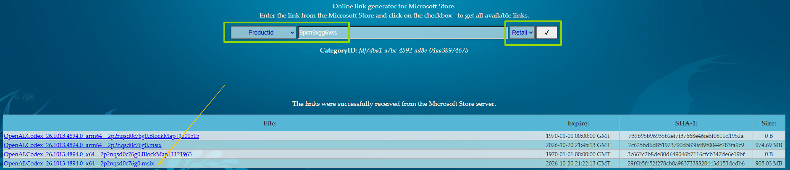
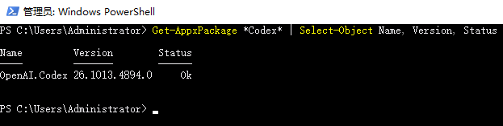
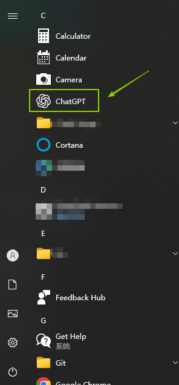

# Install ChatGpt Without Microsoft Store

October 21, 2026 & 2026-10-21

Install or Download ChatGpt(Codex) for Windows Desktop Without Microsoft Store

## Download the MSIX package

Go to [store.rg-adguard.net](https://store.rg-adguard.net/), select `ProductId` and `Retail`, enter `9plm9xgg6vks` ([9plm9xgg6vks](https://apps.microsoft.com/detail/9plm9xgg6vks) is the Microsoft Store product ID for ChatGPT).



Choose the package that matches your PC: arm64 or x64. Mine is x64.

## Run the install command

> On Windows, hold Shift and right-click the file, then choose "Copy as path".
>
> If you get a `Microsoft.WindowsAppRuntime` error, you may need to install or update the [Windows App SDK](https://learn.microsoft.com/en-us/windows/apps/windows-app-sdk/downloads-archive).

Get the local path of the package you downloaded, open `Windows PowerShell`, replace `{your file path}` below with it, then run the command:

```powershell
Add-AppxPackage -Path "{your file path}"
```

## Verify the installation

Run the following command in `Windows PowerShell`:

```powershell
Get-AppxPackage *Codex* | Select-Object Name, Version, Status
```

If you see output like this, the installation succeeded:



You will also find the ChatGPT app in the Start menu:


